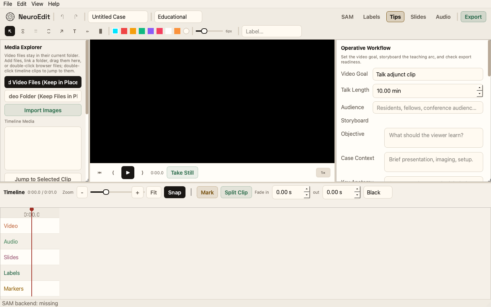
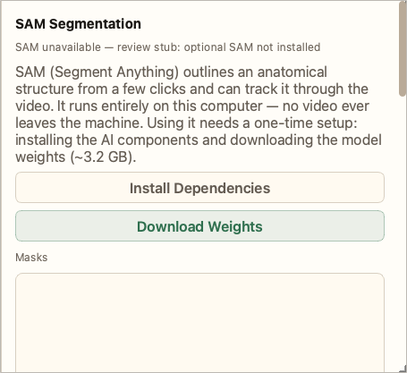
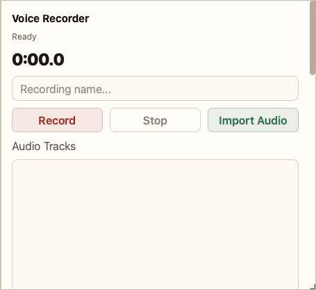
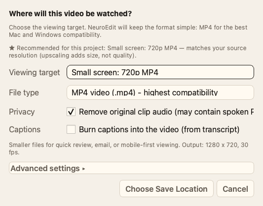
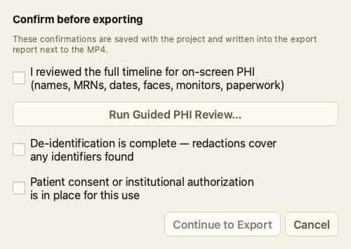
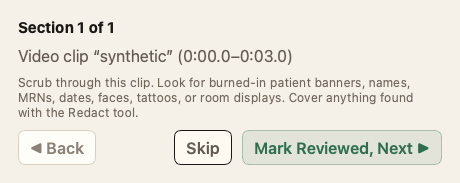

# NeuroEdit feature, implementation, and product review

Date: 2026-11-07. Reviewed checkout: `81a405f` (v0.5.13 source plus release documentation).

## Recommendation

Make NeuroEdit dependable for a small group of clinicians who repeatedly turn operative recordings into teaching clips. The user selected repeat clinician use as the next-phase goal during this review. Optimize for completing a second real editing task, rather than expanding the feature list.

The strongest initial offer is: **Prepare an authorized operative recording as a labeled teaching clip, with redactions and a reviewable export, on your own computer.** This is a positioning hypothesis to test. Local processing and review attestations do not establish complete de-identification, clinical accuracy, institutional approval, or compliance.

Start with five surgeon educators, fellows, or residents in one accessible specialty, preferably people who prepare videos at least monthly. Favor one primary desktop platform for the initial cohort, chosen from their actual machines. This keeps support and validation manageable without changing existing platform support.

## Scope and evidence

The main agent coordinated three `gpt-6-luna` reviewers: feature functionality, engineering/optimization, and current competitors/substitutes. The main agent checked their important source findings, ran fresh checks and controlled probes, inspected fresh screenshots, and made the final prioritization. No application source, dependencies, preferences, release artifacts, or existing `desktop/qa/` content were changed.

Evidence categories used below:

- **Verified execution:** current source suite, lint, and small controlled probes.
- **Source confirmed:** a behavior or missing path established by reading the implementation; not a packaged-app observation.
- **Measurement hypothesis:** potentially expensive work whose user impact is not established.
- **Product hypothesis:** an adoption assumption to test with clinicians.

Fresh validation from `desktop/`:

```sh
PATH=/private/tmp/neuroedit-security-bin:$PATH QT_QPA_PLATFORM=offscreen PYTHONPATH=src \
  /private/tmp/neuroedit-security-20261106/bin/python -m pytest tests/ -q \
  --disable-warnings -o faulthandler_timeout=120
# 301 passed in 85.47s; successful process exit, no skips

/private/tmp/neuroedit-security-20261106/bin/python -m ruff check src tests scripts
# All checks passed!
```

The isolated runtime and bundled arm64 FFmpeg already existed from the previous review. Tests redirect QSettings to temporary INI files. Screenshot capture also used temporary settings and storage. SAM probing was stubbed; actual model inference, Windows execution, clean installer behavior, real clinical footage, physical audio playback, and assistive technologies were not exercised. This was not a new security audit. The historical partial scan remains partial.

## Current feature inventory

Source paths in this report are relative to `desktop/src/neuroedit_desktop/` unless otherwise stated. Dedicated tests demonstrate software behavior, not clinical or anatomical validity.

| Feature | Current implementation and evidence | Readiness and limitation |
|---|---|---|
| Media import and library | Video/image import, drag-and-drop, folder linking, external references, search/sort, neutral library previews, and missing-media counts. `ui/main_window.py:1578`, `ui/project_library.py:74`; headless/library tests. | Usable foundation. Folder import is top-level only. Moved files cannot be relinked in place. Probing runs on the UI thread. |
| Timeline and persistence | Bounded split/trim, ripple edits, explicit magnetic reorder, snapping, markers, fades, undo/redo, autosave, Save As with managed assets. Timeline, history, and lifecycle tests. | Substantial core implementation. Decoder transitions and real long cases still need observed usability/performance testing. |
| Annotations and teaching composition | Rectangle, ellipse, arrow, text, freehand highlights, presets, slides, stills, and Take Still insertion. `ui/main_window.py:1772`, `ui/editor_panels.py:1783`; still/redaction regression tests. | Relevant to a teaching workflow. Expert judgment is still required for anatomical labels and tracking. |
| Privacy review | Opaque redactions, guided/resumable PHI review, review invalidation after content changes, metadata stripping, source-audio removal, export checklist/report. `ui/export_workflow.py:37`; PHI/redaction/storage tests. | Differentiated workflow assistance. Review is user attestation; it does not automatically find every identifier or prove an output safe. |
| Audio | Record/import narration, edit start/duration/volume, include tracks in exported mix. `ui/audio_panel.py:39`, `exporter.py:1040`. | Incomplete editing loop: added tracks are not auditioned on the timeline. Failed duration probing falls back to five seconds. |
| Captions | Write/import timestamped transcript segments, cue formatting, canvas preview, burn-in, SRT/VTT export. `ui/audio_panel.py:117`, `:577`, `captions.py:53`; caption tests. | Implemented transcript-to-caption workflow. No automatic speech transcription. |
| SAM | Single-frame segmentation, tracking/propagation, masks, job progress, stale-project-result rejection. `sam_backend.py`, `ui/sam_workflow.py`; workflow tests stub inference. | Optional source-build feature. Packaged builds exclude the ML dependencies (`desktop/NeuroEdit.spec:64`). Single-frame cancellation is ineffective. |
| Distribution | macOS/Windows packaging, pinned release constraints, CI quality gate. Root README and release workflows. | Installers are unsigned. Yesterday's publication is recorded in HANDOFF; installation and Windows UI were not revalidated in this review. |

## Prioritized implementation work

Priority reflects the repeat-use goal. Effort is a rough engineering estimate for one familiar developer including focused verification; it is not a delivery commitment and excludes external account/hardware delays.

| Order | Work and reason | Smallest useful implementation | Acceptance and estimated effort |
|---|---|---|---|
| 1 | Fix clipped import and export text. People need to read actions and privacy choices. **Verified screenshots and geometry.** | Shorten import button titles while retaining Keep in Place explanations nearby; wrap or widen the export source-audio control. | All text visible at the supported minimum window size and normal desktop scaling; repeat Windows 100/125/150% checks if those users join. About 0.5–1.5 days. |
| 2 | Add narration audition. Exporting to check synchronization makes routine editing cumbersome. **Source confirmed.** | Preview active narration tracks against the timeline clock; support seek, pause, volume, clip transitions, and still intervals. Match export inclusion rules. | Synthetic tone/impulse fixture checks seek and onset alignment against export; real listening confirms the mix; pause/seek/undo and source-mute behavior covered. About 4–8 days; greatest uncertainty in Qt audio synchronization. |
| 3 | Add missing-media relinking. External-drive references are useful only if an edited project can recover after a path changes. **Source confirmed.** | Select a replacement for an existing reference, retain clip identity/edits, validate readability and source bounds, and invalidate relevant review approvals/caches. Start with one-file repair; avoid silent filename-based matching. | Move a synthetic source, relink, preserve trims/labels/markers, undo, save/reopen, and export. Include audio and still assets in the recovery design. About 2–4 days for bounded video relink; other asset types add scope. |
| 4 | Keep import responsive during probing. This is on the main user path. **Verified injected-delay probe.** | Perform metadata probes in a worker, return results in selection order, and retain one import/undo transaction. Keep error/cancel behavior explicit. | A slow fake probe leaves a Qt heartbeat running; partial failures and cancellation preserve valid project state; real 1080p/4K/external-drive smoke. About 2–4 days. |
| 5 | Reject failed audio probing rather than inventing duration. **Verified fallback.** | Show an actionable unreadable-audio error and do not silently create a five-second track. | Probe timeout/corrupt input does not add a guessed track; valid WAV/M4A import and export remain intact. About 0.5–1 day. |
| 6 | Make single-frame SAM cancellation truthful. Relevant before encouraging source-build testers to use SAM. **Verified worker probe plus source trace.** | Check cancellation before/after inference, discard a cancelled result and its generated files, and explain if in-progress inference must finish before cancellation completes. | Cancel during blocked fake inference: no annotation attached or orphan output retained; busy state eventually clears; uncancelled path still works. About 0.5–2 days. This does not require promising interruption of a running GPU kernel. |

Items 2 and 3 can swap if initial sessions show that clinicians mostly use silent clips or frequently move drives. Start observing users while these improvements are being scoped; discovery does not require finishing the whole table.

### Evidence behind the findings

**Audio preview and duration:** `ui/main_window.py:235` wires the media player to source video audio. `ui/audio_panel.py` records/imports and edits tracks but supplies no timeline audition path. `exporter.py:1040` separately collects and mixes those tracks. No actual listening comparison was performed. `ui/audio_panel.py:415` returns `5.0` when probing fails; a controlled call with a failed probe returned exactly five seconds.

**Relinking:** `ui/main_window.py:1925` reports unavailable sources and tells users to restore or re-import files. The import path at `:1637` creates a new clip, rather than repairing the existing reference. No relink action/dialog was found in the current source. Replacing content must reset review approvals even when the path looks familiar.

**Synchronous import:** `ui/main_window.py:1663` loops through probes on the calling UI thread; `:1637` calls `probe_video`, implemented with OpenCV in `video_probe.py:6`. A 250 ms injected probe took 255.43 ms and delivered zero callbacks from a 10 ms Qt timer during the call; one arrived after event processing resumed. This proves the blocking structure, not the frequency or duration of stalls on typical user media. A single short synthetic clip imported in 145.16 ms in the capture run; that is not a representative import benchmark.

**SAM cancellation:** `ui/sam_workers.py:65` sets `_cancelled`, but `run()` does not read it before emitting a successful result. The controlled fake backend requested cancellation during inference; the real worker still emitted its result with no error. `ui/sam_workflow.py:312` checks project context, not cancellation, before accepting results. Actual ML inference was not run.

Exact controlled outputs are saved in [probe-evidence.json](probe-evidence.json) and [capture-evidence.json](capture-evidence.json). These probes used synthetic/stubbed inputs and changed no production files or settings.

## Optimization decisions

Keep the existing diagnostics and use representative recordings before replacing caches or history architecture.

| Area | Current evidence | Decision |
|---|---|---|
| Timeline static cache | Every cached repaint rebuilds tuples over project items (`ui/editor_panels.py:354`, `:382`). Forty-call microbenchmarks gave median/p95 fingerprint times of 0.150/0.159 ms for 100 annotations, 0.491/0.797 ms for 1,000, and 1.832/2.428 ms for 5,000. | Scaling cost is measurable, but this is only cache-key construction, not total frame cost. Profile realistic projects before adding revision tracking across mutations. |
| Caption/annotation canvas | `_time_state` and caption painting build list/transcript fingerprints (`ui/canvas.py:560`, `:144`). | Measure caption-heavy scrubbing. Pursue indexing or explicit invalidation only if it materially affects interaction latency. |
| Undo/autosave | Full `to_dict()` remains in history pushes; cached dictionary reuse, no-op serialization avoidance, history caps, and atomic saving already exist (`ui/history.py:102`, `project_store.py:36`). | Preserve correctness. Do not repeat the stale claim that every path does redundant full serialization. Benchmark before changing the state model. |
| Background jobs | Export/SAM workers already exist; import probing is the clearer main-thread exception. | Fix the measured call path first. Do not add a generalized job framework. |

For a representative synthetic case and an authorized long recording, record machine/build, resolution/codec, clip and overlay counts, import/project-open time, scrub latency, paint timings, memory, and export wall time. A proposed interaction target is p95 paint time below 33 ms on the chosen pilot machine; seek/decode latency is a separate measurement. Do not equate paint speed with responsive scrubbing. Keep diagnostics free of patient content and identifying paths.

## Fresh screen audit

Scope: bounded editing, optional-feature, audio, and export states rendered offscreen with the app's real widgets. This is not an observed clinician journey or full accessibility audit. Captured in the light theme at a 1440×900 editor size; dialogs use their own natural sizes. A loaded-video screenshot whose canvas stayed black was rejected as playback evidence. The empty editor below is intentionally empty, not a decoder result.

1. **Enter the editor / find import.** The media, canvas, timeline, and inspector are distinct. Both import buttons visibly clip their titles. Measured button width is 226 px; text widths are 248 and 301 px before padding. Shorter titles and visible Keep in Place guidance would reduce first-task friction. Symbol-only annotation tools also warrant keyboard and screen-reader checks.

   

2. **Inspect optional SAM.** The explanation says what segmentation does and exposes dependency/weight setup. The screenshot is a source-build missing-backend state with a stubbed probe. It is not evidence that installers can activate SAM; `ui/sam_workflow.py:171` handles frozen builds separately. Give pilot users a clear unavailable-feature explanation and keep manual labels usable.

   

3. **Inspect narration.** Record/import controls are clear, but no audition control appears in this state or in the source workflow. The transcript/caption controls sit further down the same scroll area, so first-session discoverability should be observed rather than assumed.

   

4. **Choose export settings.** The source-resolution recommendation and simple MP4 default are helpful. The source-audio removal checkbox visibly truncates the spoken-PHI text; its 380 px widget must also accommodate a checkbox indicator and spacing alongside 379 px of text. Fix this before relying on it as informed user guidance.

   

5. **Review before export.** The checklist distinguishes timeline review, de-identification, and authorization, and links to guided review. The guided review has explicit Skip and Mark Reviewed actions. Those are useful interaction patterns, but neither this screenshot nor a checked box establishes that review was thorough.

   

   

Accessibility follow-up: exercise complete keyboard navigation, focus visibility, accessible names for symbol buttons, text at scaling settings, and native VoiceOver/Narrator output. Screenshots identify likely risks; no assistive-technology compliance claim is made. The original baseline capture script switched panels too quickly and produced mislabeled states; only separately settled and inspected captures are retained here. Fixing that QA harness is a small follow-up, not an application defect established by this review.

## Competitive position and business choices

Official sources checked November 7, 2026:

- [Apple iMovie support](https://support.apple.com/imovie) documents video/sound editing and sharing. [DaVinci Resolve](https://www.blackmagicdesign.com/products/davinciresolve) combines editing, color, effects, and audio and offers a free edition. Basic cutting and titles face strong existing substitutes.
- [Medtronic Touch Surgery Video](https://www.medtronic.com/en-us/healthcare-professionals/specialties/touch-surgery/video.html) describes a private cloud video library accessible across devices. [Stryker surgical media management](https://www.stryker.com/us/en/communications/products/isuite-media-management.html) describes archiving, editing, sharing, and institutional connectivity. These are broader workflows than local clip preparation.

**Inference:** NeuroEdit has a plausible niche in individual teaching-video preparation with surgical labels, stills, redactions, review prompts, and simple local exports. These sources establish alternatives, not unmet demand. The advantage must show up as less effort and a better completed teaching deliverable compared with what the clinician already uses.

For the pilot, use a clearly scoped evaluation offer and hands-on support. Root `LICENSE` reserves use rights absent written permission, so make the owner's permission for participating testers explicit. Clarify local processing accurately: users can choose externally synced folders and optional model downloads require network access; avoid an absolute promise that the operating environment can never upload content. Do not change storage settings or third-party terms as part of this review.

Signing/notarization is a concrete adoption investment if installation warnings block otherwise interested clinicians. For an initial assisted evaluation, measure that friction first. Before wider self-serve distribution, prioritize signed delivery, a tested install path, and clear supported-platform expectations. Do not make a feature roadmap contingent on hypothetical enterprise procurement.

Defer pricing optimization until repeated use exists. Later, test individual-license and supported annual-license offers with actual repeat users. No evidence here establishes willingness to pay, market size, or the need for institutional sales.

## Pilot plan and decision gates

**Proposed target:** five enrolled clinicians; at least four complete a first teaching clip with no more than one intervention; at least three independently complete a second distinct editing session and export within 30 days of onboarding. These are decision thresholds for this pilot, not industry benchmarks. If a participant has no second eligible task during that period, record that separately rather than classifying it as a product failure or counting it as retention.

| Stage | Work | Evidence to advance |
|---|---|---|
| First week | Owner identifies five accessible educators and their next real teaching task. Observe three baseline workflows; capture their current editor, frequency, source format, machine, time spent, and biggest interruption. Run a consistent synthetic task in NeuroEdit. Fix clipped actions early. | People have a recurring task and can reach a usable first output. Record exact failures, help needed, and reasons to stop. |
| Next focused build | Prioritize narration audition and relink according to the observed task; remove slow-import stalls and false audio duration when encountered. Test the cohort's actual packaged platform(s). Use a short first-case guide and synthetic practice project. | Install → import → trim → label/still → redact/review → export → reopen works on target machines. Returned projects survive the cohort's normal storage workflow. |
| Following 30 days | Let participants choose NeuroEdit for a second task. Log sessions/exports through opt-in observation or a small manual diary; collect no patient footage or automatic telemetry by default. Offer a weekly short check-in. | At least three independently return and export again; completed videos are useful to the educator; fixes follow observed blockers. |
| Decision | Review retained users and non-return reasons. Compare task time and assistance against each person's previous workflow. | Continue if repeat use and a recurring advantage exist. Narrow to silent teaching clips if audio is rarely needed. Revisit the segment if projects are too infrequent or generic editors remain adequate. |

Measure time to first usable export, interventions per task, missing-media incidents, failed exports, time spent checking audio, installation abandonment, and repeat completion. Measure speed against comparable tasks and footage complexity. Ask an educator to review teaching clarity; do not infer learner benefit from feature use or test results.

Defer cloud libraries, automatic PHI detection, ASR, bundled SAM, DICOM/HL7/FHIR, multi-camera/fluorescence composition, enterprise dashboards, and broad architectural rewrites until repeat users demonstrate a specific unmet task. Keep the existing Stryker work parked pending actual source examples and workflow demand.

## Immediate next action

Recruit the five-person cohort and schedule the first three observation sessions while preparing a small usability build. Fix clipped controls first, then choose narration audition or media relink from those sessions. Keep the current suite green and make the next release's acceptance criterion a completed, repeatable clinician workflow.
